# Data Flow

[← Back to README.md](../README.md)

## Data Flow Diagram

Visualizes how PURL arrays are processed, external API calls (deps.dev / GitHub GraphQL & REST / OpenSSF Scorecard / OSV.dev) are made, and results are assembled respecting Clean Architecture (DDD) boundaries.

### PURL Batch Processing — External API Calls and Data

```mermaid
flowchart LR
    A["PURLs / GitHub URLs"] --> B["Parse & validate<br/>PURL or URL kind"]
    B --> C["deps.dev: Fetch Package Info<br/>(parallel)"]
    C --> D{Has repository URL?}
    D -->|Yes| E["Normalize & Group by repo URL"]
    E --> F["deps.dev: Fetch Project Info (batch by repo)"]
    F --> G["Merge Package + Project"]
    D -->|No| H["Build basic result<br/>(package-only)"]

    G --> I["GitHub: Fetch metadata<br/>(parallel, rate-limited)"]
    I --> J["Scorecard: Run checks<br/>(parallel, respect quotas)"]

    H --> K["Domain: Aggregate → Analysis"]
    J --> K
    K --> L["Interfaces/CLI: CSV/Report"]

    classDef infra fill:#eef,stroke:#88f,stroke-width:1px;
    classDef app fill:#efe,stroke:#4a4,stroke-width:1px;
    classDef domain fill:#ffe,stroke:#cc4,stroke-width:1px;
    classDef iface fill:#fee,stroke:#f88,stroke-width:1px;

    class B,C,F,I,J infra;
    class E app;
    class K domain;
    class L iface;
```



### External API Calls and Retrieved Data

#### deps.dev — PURL Lookup (GET /v3alpha/purl/{purl})

- Returned Version fields: `versionKey.version`, `purl`, `publishedAt`, `isDefault`, `licenses`, `links (SOURCE_REPO)`, `relatedProjects`, etc.
- Purpose: Retrieve canonical package info; discover repository URL via SOURCE_REPO link
- Code: `DepsDevClient.fetchPackageInfo` (`internal/infrastructure/depsdev/depsdev.go`)
- Docs: <https://docs.deps.dev/api/v3alpha/>

#### deps.dev — Project Batch (POST /v3alpha/projectbatch)

Returns Project info for each projectKey (e.g., github.com/owner/repo):

- `ProjectKey.ID`, `StarsCount`, `ForksCount`, `OpenIssuesCount`, `License`, `Description`, `Homepage`
- Scorecard block: `date`, `repository{name, commit}`, `overallScore`, `checks{name, score, reason, details, documentation{url}}`

- Purpose: Enrich with repo-level metadata and OpenSSF Scorecard metrics
- Code: `DepsDevClient.fetchProjectsBatch` (`internal/infrastructure/depsdev/depsdev.go`)
- Types: `ProjectBatchRequest` (`internal/infrastructure/depsdev/api_types.go`)
- Docs: <https://docs.deps.dev/api/v3alpha/#getprojectbatch>

#### deps.dev — GetDependents (GET /v3alpha/systems/{system}/packages/{name}/versions/{version}:dependents)

- Returned fields: `dependentCount`, `directDependentCount`, `indirectDependentCount`
- Supported observations: npm, Maven, PyPI, Cargo. Go is skipped; a 404 or failed request is unknown, not measured zero.
- Purpose: Record direct and total counts of public packages whose computed resolution includes the queried version. The version is the caller's pinned version, or the resolved version for versionless input. See ADR-0032.
- Code: `DepsDevClient.FetchDependentCount`, `FetchDependentCountBatch` (`internal/infrastructure/depsdev/dependents.go`)
- Types: `DependentsResponse` (`internal/infrastructure/depsdev/api_types.go`)
- Docs: <https://docs.deps.dev/api/v3alpha/>

#### RubyGems — Reverse Dependencies (GET /api/v1/gems/{name}/reverse_dependencies.json)

- Returns: Array of gem names whose latest published version declares a dependency (on any version of the target), including runtime and development dependencies by default
- Purpose: Record a registry-wide direct dependents count for `pkg:gem/*` (deps.dev answers 404 for RubyGems)
- Code: `Client.GetReverseDependencyCount` (`internal/infrastructure/rubygems/client.go`)
- Docs: <https://guides.rubygems.org/rubygems-org-api/>

#### Packagist — Package Info (GET /packages/{vendor}/{name}.json)

- Returned fields: `package.dependents`, `package.suggesters`, `package.favers`
- Purpose: Retrieve dependent count for `pkg:composer/*` (deps.dev does not support Composer)
- Code: `Client.GetDependentCount` (`internal/infrastructure/packagist/client.go`)
- Note: `package.dependents` counts packages requiring the target, including `require-dev` (Packagist's default `requires=all`), across all versions of the target
- Note: Reuses existing `fetchPackage` cache (shared with `GetAbandoned` / `GetRepoURL`)
- Docs: <https://packagist.org/apidoc>

#### deps.dev — Releases (GET /v3alpha/systems/{ecosystem}/packages/{name})

- Returns: Versions list (`versionKey.version`, `publishedAt`, `isDefault`, `isDeprecated`, `deprecatedReason`) — no yank data except cargo, which reports yanks as `isDeprecated` with `deprecatedReason` `"yanked"`; see [ADR-0024](adr/0024-cargo-yank-from-depsdev.md) and [ADR-0023](adr/0023-stable-version-source.md)
- Purpose: Identify latest stable/dev/requested version and freshness. The requested version's `publishedAt` is the young-release marker's last fallback (`Analysis.ReleaseAge`, ADR-0031)
- Code: `DepsDevClient.fetchLatestRelease`, `DepsDevClient.fetchReleaseInfoBatch` (`internal/infrastructure/depsdev/release.go`)
- Docs: <https://docs.deps.dev/api/v3alpha/>

#### OSV.dev — Query batch (POST https://api.osv.dev/v1/querybatch)

- Request body: `{"queries":[{"package":{"name":"<name>","ecosystem":"<OSV ecosystem>"}}, ...]}`, at most 1,000 queries per request
- Fields consumed: per result, in request order — whether `vulns[]` is empty and whether `next_page_token` is absent
- Purpose: find, in one request, the packages OSV.dev has no advisory for, so the query below is issued only for packages that have one. Batch and query answers share one cache, and entries expire counted from when their request was sent. Answers naming an advisory win regardless of order: query records are never replaced by an empty answer, and a result naming an advisory stores a mark that sends the package to the query below and that only a query answer clears. A "no advisory" is stored as an empty record list only over another empty answer, and an empty query clears a mark only if it was sent after the batch that set it. The cost: if an advisory is withdrawn (OSV.dev then leaves it out of query answers) or stops listing the package after its records were cached, it is still reported until that entry expires (10 minutes by default; each run starts with an empty cache). A result counts as "no advisory" only when each key it reads (`results`, `vulns`, `next_page_token`) is spelled exactly and none repeats; other keys are ignored. Optimisation only: one attempt with a 10-second budget and no retry; a failed or unclear batch leaves every package to its own query
- Code: `osv.Client.PrimeNoAdvisories` (`internal/infrastructure/osv/batch.go`), `IntegrationService.primeOSVNoAdvisories` (`internal/infrastructure/integration/prime_osv.go`)
- Docs: <https://google.github.io/osv.dev/post-v1-querybatch/>

#### OSV.dev — Query (POST https://api.osv.dev/v1/query)

- Request body: `{"package":{"name":"<name>","ecosystem":"<OSV ecosystem>"}}`; paginated via the response's `next_page_token`
- Fields consumed: per advisory — `id`, `aliases[]`, `summary`, `published`, `withdrawn`, `references[]` (the entry whose `type` is `ADVISORY`); per affected entry — `package.name`, `package.ecosystem`, `ranges[].type`, `ranges[].events[]`, `versions[]`, `database_specific.informational`; per advisory — `database_specific.cwe_ids`
- Purpose: detect the RustSec `unmaintained` marker for cargo packages and record it as a package-level fact (`Analysis.AdvisoryDBState`, ADR-0025), and detect malicious-package advisories for every supported ecosystem (`Analysis.MaliciousState`, ADR-0027). Sent only for packages the query batch above did not answer as having no advisory. A body is a failed lookup, never an answer, when a key the client reads, at the place it reads it, appears twice or under two spellings `encoding/json` would fold together, is spelled other than exactly (`TYPE` for a range's `type`), or is null where null would drop an advisory or a match (`vulns`, `id`, `published`, `affected`, the package name and ecosystem, ranges, events and their bounds, `versions`, `database_specific`, `cwe_ids`). Keys the client does not read, including anything inside `database_specific` or `ecosystem_specific` other than `cwe_ids` and `informational`, are not checked; `informational: null` is how RustSec marks an advisory that is not informational. Classification happens in the domain layer, not in the client: `analysis.ClassifyUnmaintained` (package-wide range check, withdrawal check, publication-age cooldown) and `analysis.ClassifyMalicious` (record ID and CWE check, withdrawal check, version and SemVer range match)
- Code: `osv.Client.QueryPackage` (`internal/infrastructure/osv/client.go`), `IntegrationService.enrichAdvisoryDBState` (`internal/infrastructure/integration/populate_advisorydb_state.go`), `IntegrationService.enrichMaliciousState` (`internal/infrastructure/integration/populate_malicious_state.go`), `analysis.ClassifyUnmaintained` (`internal/domain/analysis/advisorydb.go`). See [ADR-0025](adr/0025-rustsec-unmaintained-is-a-weak-cargo-signal.md) and [ADR-0027](adr/0027-osv-malicious-advisories.md)
- Docs: <https://google.github.io/osv.dev/post-v1-query/>

#### npm registry — Packument (GET https://registry.npmjs.org/<name>)

- Request: the full packument (scoped names as `@scope%2Fname`); the abbreviated install document has no per-version times
- Fields consumed: `name`, `time` (per-version publish times, `created` / `modified` / `unpublished` skipped), the key set of `versions`, top-level `maintainers`, and per version `maintainers` and `_npmUser`
- Purpose: record when every version was published, including unpublished ones whose `time` entry npm keeps (`Analysis.ReleaseHistory`); the lifecycle assessor reads it against the analysed version to detect a release burst across lines after a long silence, and `Analysis.EvaluateDormantRelease` turns it into the dormant-release marker (`Analysis.DormantRelease`). The same timestamp can feed the young-release marker (`Analysis.ReleaseAge`, ADR-0031). The current maintainers, each with the earliest publish time of a version naming its address, feed the optional maintainer domain check below (`ReleaseHistory.Maintainers`, ADR-0030). Each account's latest dated `_npmUser` publish, the `time` of versions missing from `versions` or naming no `_npmUser` (only when `versions` is present), and the current maintainer accounts give the publisher e-mail evidence attached to flagged findings (`ReleaseHistory.PublisherHistory`, read across every npm packument of the analysis batch; no extra request). The account's latest dated publish in the flagged package alone gives `package_publish`, and each version's `_npmUser.name`, classified when the packument is read (`ReleaseHistory.PublisherKinds`), gives `version_publisher` for the analysed version (ADR-0030; no extra request). One request per distinct npm package, for versioned PURLs only
- Code: `npmjs.Client.GetPublishHistory` (`internal/infrastructure/npmjs/client.go`), `IntegrationService.enrichReleaseHistory` (`internal/infrastructure/integration/populate_release_history.go`), `analysis.DetectDormantBurst` and `analysis.DetectFreshDormantRelease` (`internal/domain/analysis/release_history.go`). See [ADR-0026](adr/0026-dormant-release-burst.md) and [ADR-0028](adr/0028-dormant-release-marker.md)
- Docs: <https://github.com/npm/registry/blob/main/docs/responses/package-metadata.md>

#### PyPI registry (GET https://pypi.org/pypi/<project>/json; conditional GET https://pypi.org/pypi/<project>/<version>/json)

- Fields consumed for release age: `releases[version][].upload_time_iso_8601` in the project response and `urls[].upload_time_iso_8601` in the version response; the earliest valid file time for the analysed version becomes `Analysis.PyPIPublishedAt`.
- Purpose: feed `Analysis.ReleaseAge` when a PyPI response is already fetched for the summary, inactivity classification, or version-yank evaluation. The release-age marker makes no new request. If neither response yields a time, deps.dev's requested-version time is used; absent that, JSON reports `unknown` (ADR-0031).
- Code: `pypi.Client.GetProject` and `GetVersion` (`internal/infrastructure/pypi/client.go`), `IntegrationService.enrichPyPISummary` (`internal/infrastructure/integration/populate_summary.go`), and `eolevaluator.Evaluator` (`internal/infrastructure/eolevaluator/evaluator.go`).

#### IANA — RDAP bootstrap registry (GET https://data.iana.org/rdap/dns.json)

- Sent only with `scan --maintainer-domain`, once per run, before the first npm package is checked; skipped while the cached copy has not expired. An expired copy is revalidated with `If-None-Match` when it has an ETag (304 keeps it)
- Fields consumed: `publication`, `services` (TLD lists and their first https URL); headers `Cache-Control` (`max-age`, `no-cache`, `no-store`), `Age`, `Expires`, `ETag`. The copy expires after `max-age` less `Age`, else at `Expires`, capped at one year; `no-cache` or `no-store` makes it stale at once, and a `no-store` response is not written
- Purpose: keep the TLD-to-RDAP-server list current (RFC 9224 section 4). The copy is cached at `<user cache dir>/uzomuzo/rdap/dns.json` (mode 0600). A failed request, a response over 1 MiB, malformed JSON, a list without an RFC 3339 `publication`, or a list without https services (with a host and no user info) is not adopted; the embedded copy is used instead. No retry. JSON reports the list used as `rdap_bootstrap` (`source`: live, cache, embedded; `publication`)
- Code: `rdap.Client.RefreshBootstrap` (`internal/infrastructure/rdap/bootstrap.go`), `AnalysisService.refreshRDAPBootstrap` (`internal/application/analysis_service.go`). See [ADR-0030](adr/0030-maintainer-email-domain-marker.md)
- Docs: <https://www.rfc-editor.org/rfc/rfc9224#section-4>

#### RDAP — Domain (GET <RDAP base>/domain/<registrable domain>)

- Sent only with `scan --maintainer-domain`, for each current npm maintainer address that has a valid mail host, appears in a dated version's `maintainers` or `_npmUser`, and whose mail host and registrable domain (public suffix list) are not a shared mail provider or a private suffix. The base URL is the first https service listed for the TLD in the IANA DNS bootstrap registry (fetched as above, or the copy embedded in the binary, `internal/infrastructure/rdap/bootstrap.json`); TLDs without one are not queried
- Fields consumed: `events[]` (`eventAction` = `registration`, `eventDate`), `status[]` (`redemption period`, `pending delete`), and the `fn` of the vCard of the entity whose role is `registrar`. HTTP 404 means unregistered
- Purpose: classify each address against the address's first appearance and the scan time (`Analysis.MaintainerDomain`, `analysis.ClassifyMaintainerDomain`). At least one second between lookups sent to one RDAP server (redirect hops a lookup follows are not spaced), 10-second timeout, one retry after 30 seconds on a transport error, a response body cut off, or HTTP 408, 429 or 5xx; redirects are limited to 5 and may not leave https; a refused redirect is not retried. Domain records are kept in memory for the run
- Code: `rdap.Client.Check` and `rdap.Client.Lookup` (`internal/infrastructure/rdap/client.go`), `AnalysisService.checkMaintainerDomains` (`internal/application/analysis_service.go`), `analysis.ClassifyMaintainerDomain` (`internal/domain/analysis/maintainer_domain.go`), `analysis.PublisherEmailEvidenceFor` (`internal/domain/analysis/publisher_email_evidence.go`), `analysis.PackagePublishFor` and `analysis.VersionPublisherKindFor` (`internal/domain/analysis/package_publish.go`). See [ADR-0030](adr/0030-maintainer-email-domain-marker.md)
- Docs: <https://www.rfc-editor.org/rfc/rfc9083>, <https://www.rfc-editor.org/rfc/rfc9224>

#### GitHub — GraphQL (POST https://api.github.com/graphql)

- Query repository(owner, name) fields: `isArchived`, `isDisabled`, `isFork`, `stargazerCount`, `forkCount`, `description`, `homepageUrl`, `primaryLanguage{name}`, `licenseInfo{spdxId, name}`, `repositoryTopics(first:20){nodes{topic{name}}}`, `defaultBranchRef{name, target{... on Commit { history(first:N){nodes{committedDate, author{user{login}}}}}}}`, `rateLimit{cost, remaining, resetAt}`
- Purpose: Evaluate repository state (archived/disabled/fork), recent commit activity, and surface metadata (description → Repository.Summary, topics → Repository.Topics, primaryLanguage → Repository.Language)
- Code:
  - Basic info query: `Client.FetchBasicRepositoryInfo` (`internal/infrastructure/github/client.go`)
  - Batch orchestration: `Client.fetchRepositoryStatesBatch` (package-internal)
  - HTTP + query execution: `Client.executeGraphQLQuery`
- Docs: <https://docs.github.com/en/graphql>

### Implementation Notes

- Parallelism is placed in the Infrastructure layer; Application coordinates; Interfaces stays thin
- Grouping and batching (e.g., repo URL → project batch) reduces API calls and improves throughput
- Repository URLs are normalized before GitHub / Scorecard calls to avoid duplicates and mismatches

### Assessment Precision: Two-Path Architecture

The lifecycle assessor uses two distinct decision paths depending on `GITHUB_TOKEN` availability:

```text
┌─────────────────────────────────────────────────────────────────────┐
│ Path A: With GITHUB_TOKEN (high precision)                         │
│                                                                     │
│ Data: deps.dev + GitHub commits + OpenSSF Scorecard                │
│                                                                     │
│ Capabilities:                                                       │
│  • Human commit recency → Active/Stalled/Legacy-Safe               │
│  • VCS-direct ecosystem detection (Go, Composer)                   │
│  • Scorecard absence vs. low score distinction                     │
│  • Zero-advisory + dormant commit → Legacy-Safe                    │
│  • HIGH/CRITICAL vulns + dormant → EOL-Effective                   │
│  • LOW/MEDIUM-only vulns + dormant → Stalled (severity-aware)      │
│  • Archive/disable → Stalled (unless explicit EOL)                 │
├─────────────────────────────────────────────────────────────────────┤
│ Path B: Without GITHUB_TOKEN (basic precision)                     │
│                                                                     │
│ Data: deps.dev only (publish dates, advisories, severity)          │
│                                                                     │
│ Capabilities:                                                       │
│  • Publish recency + advisories → coarse classification            │
│  • Archive via Scorecard "Maintained" → Stalled (unless EOL)       │
│  • No commit signals → cannot detect active-but-unpublished        │
│  • Packages with commits but no publish → misclassified as Stalled │
└─────────────────────────────────────────────────────────────────────┘
```

The domain layer branches on `Analysis.HasCommitData()` to prevent sentinel values (9999 days) from leaking into commit-based comparisons when commit history is unavailable. See [Assessment Precision](../README.md#assessment-precision-by-data-availability) for the full capability comparison.

### Advisory Severity Enrichment

The lifecycle assessor is severity-aware: only HIGH or CRITICAL advisories trigger the EOL-Effective classification when combined with dormant maintenance.

- **Data source**: deps.dev advisory API (`GET /v3alpha/advisories/{id}`) provides CVSS3 scores for each advisory.
- **Scope**: Only Stable and MaxSemver versions are enriched with severity data (per ADR-0010). Development/pre-release versions skip severity enrichment to reduce API calls.
- **Severity thresholds**: CVSS3 >= 7.0 is classified as HIGH; CVSS3 >= 9.0 is classified as CRITICAL. The threshold is configurable via `HighSeverityCVSSThreshold` (default 7.0).
- **Fallback behavior**: When the advisory API is unavailable or returns no CVSS3 score, the advisory is conservatively treated as HIGH severity (same behavior as before the severity-aware change). This ensures no regression in detection coverage.
- **Classification impact**:
  - HIGH/CRITICAL advisory + dormant (2+ yrs without human commits) → **EOL-Effective**
  - LOW/MEDIUM-only advisories + dormant → **Stalled** (not escalated to EOL-Effective)

### Transitive Advisory Scanning

In addition to direct advisories (reported by the deps.dev PURL API), uzomuzo fetches advisories from transitive dependencies:

1. **Reuse dependency graph** — the `GetDependencies` response (already fetched for dependency counts) provides the full resolved dependency tree.
2. **Fetch transitive advisory keys** — each dependency node is queried via the PURL endpoint in parallel (10 goroutines max) to collect `advisoryKeys`.
3. **Enrich with severity** — the existing `FetchAdvisoriesBatch` pipeline adds CVSS3 scores and severity labels.
4. **Deduplicate** — if a transitive advisory ID matches a direct one, `DIRECT` wins.

Transitive advisories are distinguished from direct advisories via `Advisory.Relation` (`DIRECT`/`TRANSITIVE`) and `Advisory.DependencyName` (e.g., `qs@6.5.5`). All output formats (detailed box, JSON, CSV) display them separately.

**Ecosystem limitation:** Transitive advisory scanning reuses the `GetDependencies` graph, so it shares the same ecosystem restriction: npm, Maven, PyPI, and Cargo only. Go, NuGet, and RubyGems packages do not receive transitive advisory data.

---

## EOL Detection

EOL detection uses two complementary approaches:

### 1. Registry Heuristics (`eolevaluator`)

Automatic detection from external registry APIs (built-in):
- PyPI classifiers (`Development Status :: 7 - Inactive`)
- npm deprecated flag
- Packagist abandoned flag
- NuGet deprecated flag
- Maven relocated artifact

### 2. Custom Catalog via AnalysisEnricher

External callers can inject EOL catalog data via the `WithEnricher` hook. See [Library Usage](library-usage.md) for details on the enricher pattern, catalog JSON format, and integration flow.
